<div align="center">

# 🔥 HELLDROP

### Reverse-Doom: you don't *play* the Doom Guy — you **kill** him.

An AI-controlled Doom marine fights through real Doom levels, rendered
isometrically. You are Hell. You drop demons onto his route and spend his own
spilled blood to do it. He's trying to reach the exit switch. **Stop him.**


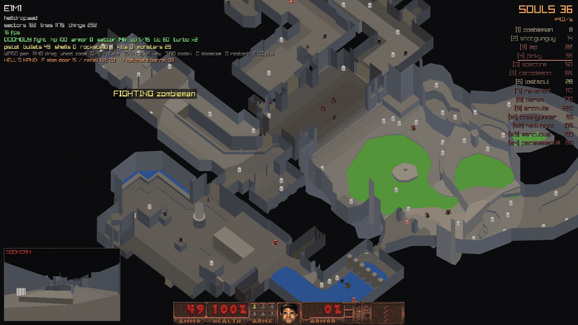

*Souls drip in. You drop a pain elemental behind a pillar. He turns to fight,
takes a hit — and every drop of his blood pays for the next demon. The status
bar is his life. The mugshot bloodies as you win.*

▶ **[Watch the full-quality clip (MP4)](media/helldrop-gameplay.mp4)**

</div>

---

## Table of contents

- [The pitch](#the-pitch)
- [The core loop](#the-core-loop)
- [Quick start](#quick-start)
- [Screenshots](#screenshots)
- [Controls](#controls)
- [Game systems](#game-systems)
  - [The Pain Tithe (economy)](#the-pain-tithe-economy)
  - [Doom Guy: the brain](#doom-guy-the-brain)
  - [The threat ledger (how he targets)](#the-threat-ledger-how-he-targets)
  - [Navigation](#navigation)
  - [The bestiary](#the-bestiary)
  - [The Corpse Bank](#the-corpse-bank)
  - [Hell's Hand](#hells-hand)
  - [Darkness & the doomcam](#darkness--the-doomcam)
- [Campaign: Knee-Deep in His Blood](#campaign-knee-deep-in-his-blood)
- [Architecture](#architecture)
- [The authentic-art pipeline](#the-authentic-art-pipeline)
- [The gamestate log (debugging contract)](#the-gamestate-log-debugging-contract)
- [Determinism & testing](#determinism--testing)
- [Project layout](#project-layout)
- [Legal & attribution](#legal--attribution)
- [Roadmap & known limits](#roadmap--known-limits)

---

## The pitch

Doom is a power fantasy: you are an unstoppable marine and the demons are
chum. **Helldrop inverts it.** The marine is the protagonist of *his* story —
a competent, self-directed AI that pathfinds real Doom maps, plays doors and
lifts like a speedrunner, loots ammo off the corpses you make, retreats to
medkits when he's hurt, and flips the exit switch if you let him.

You are the level's malice. You watch from an isometric remove and **spend his
blood** to spawn the monsters that hunt him. Left alone, he wins. Your job is
to read his route, his health, and his threat priorities, and to drop the
right demon in the right shadow at the right moment.

Everything you see — every sprite, sound, status-bar pixel, and level — is
decoded live from a Doom WAD. Point it at id's IWAD and it looks *exactly* like
Doom. Out of the box it ships with [its own redistributable art pack](#the-authentic-art-pipeline).

## The core loop

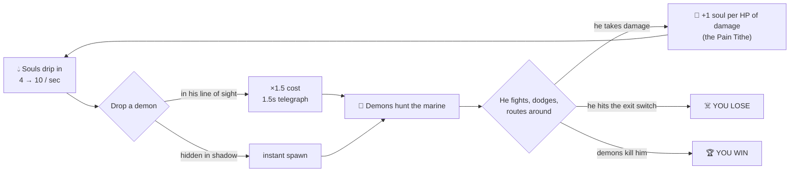

The tension is the economy. Souls trickle faster the closer he gets to the
exit (so a near-win arms you for a last stand), and **every point of damage he
takes mints a soul** — so a drawn-out fight feeds you, but a clean dash to the
switch starves you. Drops in his sightline cost 50% more and telegraph before
they spawn; drops in the dark are instant and cheap. Hell rewards the ambush.

## Quick start

```bash
git clone git@github.com:binRick/helldrop.git
cd helldrop
./run.sh            # first run builds static raylib 6.0 + fetches Freedoom (~1 min)
```

`run.sh` does an incremental `make` and launches the game attached to your
terminal. No Homebrew dependencies — raylib is vendored and statically linked.

**Native iPhone app.** With Xcode and XcodeGen installed, run `make ios-project` and open
`ios/Helldrop.xcodeproj`. Select your signing team, choose the iPhone as the run
destination, and run the Helldrop scheme. The arm64 app bundles the training
maps, Episode 1, sounds, and models for offline play. Tap the battlefield to
place a demon. The level name opens the map picker, and the options menu
contains Retry, Mute, and episode camera controls. Drag to pan and pinch to
zoom in Episode 1. The app remembers cleared lessons, best scores, and the last
map. Returning from Home pauses the run. To run the native touch regression,
select an iPhone simulator in Xcode and use Product → Test.

**Browser build.** Run `make web-serve` with Emscripten on your PATH and
open `http://localhost:8000`. Seven short lessons build from one summon to
a two-demon ambush using a door, chain blast, and a race to the medkit.
Completed lessons are marked in the level menu. The barrel lessons save your
best winning blast. The menu also opens all nine Episode 1 maps. Episode runs remember your fastest
clear per map in this browser. On touch screens, drag Episode 1 maps to pan
and use **Track marine** to follow again. The 3D models load when you enter an
Episode 1 map. Press **P** or use the browser's **Pause** button to stop the run.

Run `make test` for the native campaign regression matrix and `make test-web`
for the Chrome desktop and mobile-emulation smoke tests. The browser test
requires Node.js 22+ and Chrome or Chromium. Set `HELLDROP_CHROME` to point
to a different executable.

**Want it to look exactly like Doom?** Drop your own `DOOM.WAD` / `DOOM2.WAD`
into `assets/` (or pass `--wad <path>`). Every visual and sound is decoded from
the WAD, so an id IWAD makes the game pixel-identical to Doom. id's assets are
copyrighted and are **never** committed to this repo — you bring your own.

```bash
./run.sh --map E1M1                 # pin a single level, all demons unlocked
./run.sh --wad ~/DOOM2.WAD --map MAP01
./run.sh --map E1M3 --turbo 8 --autodrop   # fast AI/balance smoke test
```

| Flag | Effect |
|---|---|
| `--wad <path>` | Use a specific IWAD (else auto-detect → `helldrop.wad` → Freedoom) |
| `--map E1M2` | Single-level mode, full bestiary unlocked (use this for testing) |
| `--seed <N>` | Replay a deterministic variation of the combat rolls. Zero uses the default seed. |
| `--turbo <N>` | Run the sim `N`× faster — great for watching the AI quickly |
| `--autodrop` | Scripted demon waves on his route (the combat/balance smoke test) |
| `--selftest` | Render 60 frames, write `selftest.png`, exit (headless verification) |
| `--dump-frames <dir>` | Write a PNG per frame for stitching into video |
| `--no-log` · `--exit-after <N>` | Disable the NDJSON log · stop after N frames |

## Screenshots

**Anatomy of the screen** — isometric level, his-eye **doomcam** PiP (bottom
left), the **souls economy** panel with live drop costs (right), the
**hell-forged status bar**, and a floating **intent label** telegraphing his
current drive.

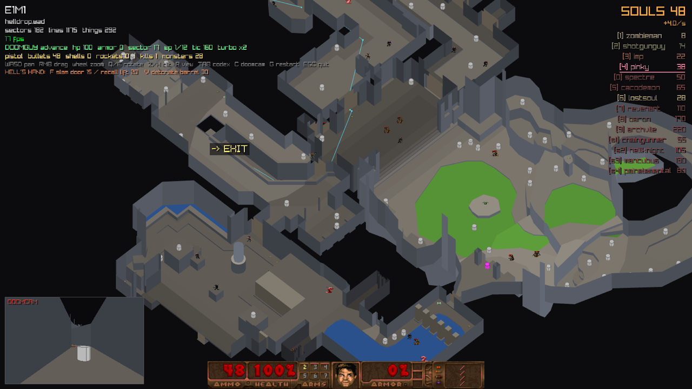

| The firefight | Genuine id art (DOOM2.WAD) |
|:---:|:---:|
| 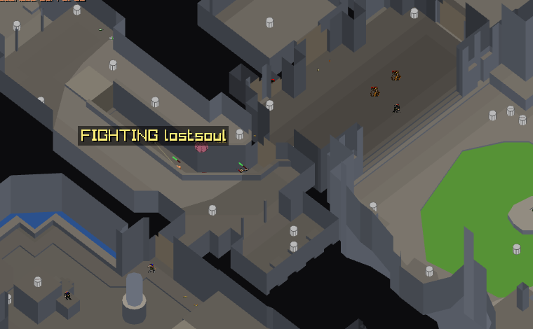 | 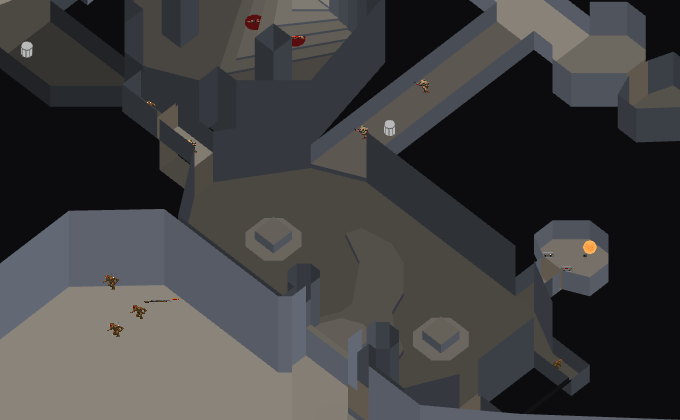 |
| He fights a lost soul mid-route; demons swarm from the right. | Point it at a real IWAD and the sprites *are* Doom. |

| Know-Your-Enemy codex (TAB) | The reckoning |
|:---:|:---:|
| 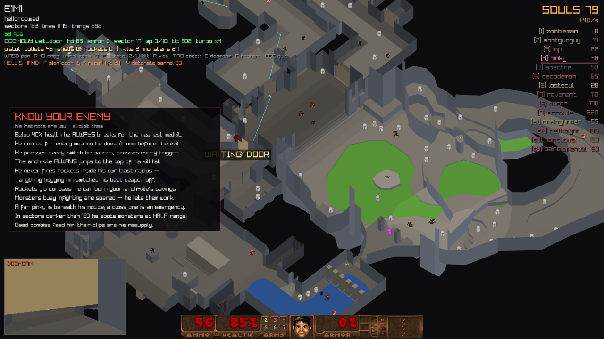 | 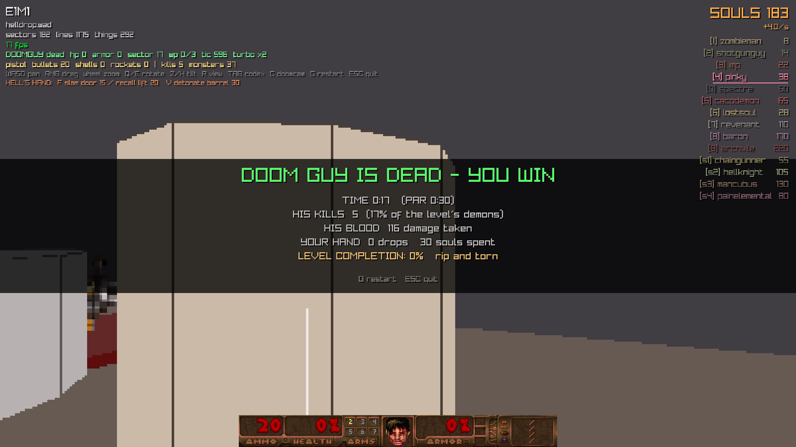 |
| His published tells — every line stays true to the code. | His death drops to a red fade, then the report card. |

**The hell-forged HUD** — Helldrop's own reskin of the Doom status bar
(`STBAR`/`STARMS` tinted toward blood-stained metal), assembled into our
shippable WAD. The mugshot bloodies as you win; ARMS slots light up as he
loots the arsenal.

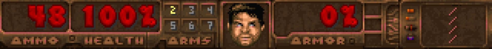

## Controls

| Key | Action |
|---|---|
| **Mouse drag** / **WASD** | Pan the isometric camera |
| **Wheel** | Zoom · **Q** / **E** rotate · **R** reset view |
| **1 – 9, 0** | Select a demon (see below) |
| **Shift + 1 – 4** | Select a Doom 2 heavy (chaingunner, hell knight, mancubus, pain elemental) |
| **Left click** | Drop the selected demon at the cursor |
| **F** | **Hell's Hand:** slam/hold the nearest door — or recall the nearest lift |
| **V** | **Hell's Hand:** detonate the nearest barrel (chain-reacts) |
| **TAB** | Toggle the Know-Your-Enemy codex |
| **C** | Toggle the doomcam (his first-person view) |
| **P** | Pause / resume |
| **U** | Mute / unmute |
| **G** | Restart the sim (deterministic — same playout) |
| **SPACE** | Advance to the next level (after a campaign win) · **ESC** quit |

**Demon hotkeys:** `1` zombieman · `2` shotgun guy · `3` imp · `4` pinky ·
`5` cacodemon · `6` lost soul · `7` revenant · `8` baron · `9` arch-vile ·
`0` spectre.

## Game systems

### The Pain Tithe (economy)

Souls are your only resource. You start with **30** and bank up to **999**.

- **Drip:** `4 + 6 × (his progress to the exit)` souls/sec — so `4/s` at the
  start of a level ramping to `10/s` as he nears the switch.
- **The Tithe:** **+1 soul for every point of damage** he takes. Hurting him
  literally pays for more demons. (Healing he picks up is *not* refunded.)
- **Hot drops:** spawning inside his line of sight costs **×1.5** and
  telegraphs for ~1.5s before the demon appears. Drops in the dark are
  instant and full price. **Ambush is cheaper than confrontation.**

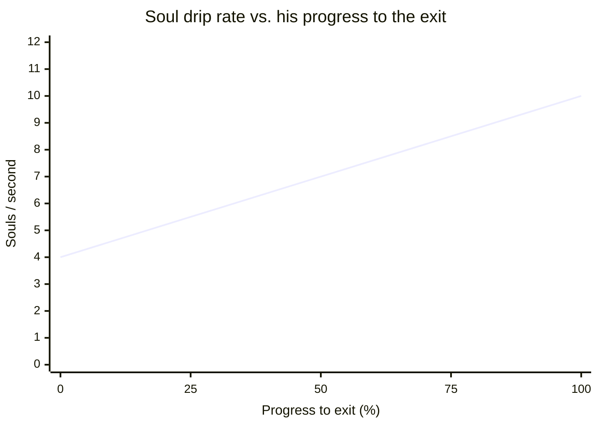

Every demon has a base soul price, climbing from chaff to nightmares:

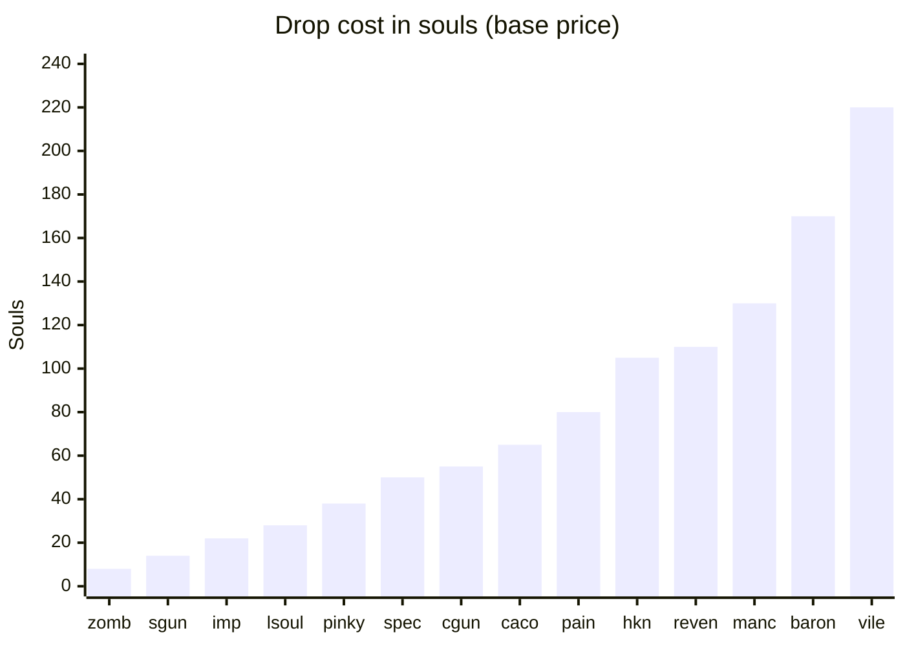

### Doom Guy: the brain

He is a finite state machine over real navigation. He follows a route to an
objective (the exit, a health pickup when hurt, or a better weapon), waits on
doors and lifts, breaks off to fight what threatens him, retreats when low,
and flips the switch if he reaches it.

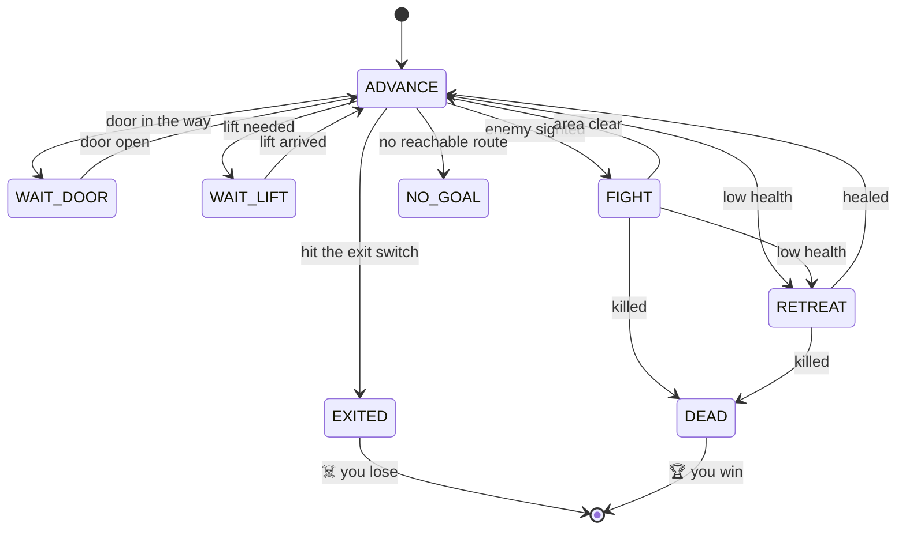

He plays the map like a speedrunner: crossing a line fires its walkover
trigger, and he presses any switch within reach every few tics. He loots clips
and shells off the zombies he kills (**Feeding the Slayer**), climbs the
**arsenal ladder** (pistol → shotgun → chaingun → rocket) when a better weapon
is reachable, and keeps rocket discipline (never fires one inside 180 units of
himself). His navigation is **self-healing**: an edge he gets stuck against is
banned for the run and he replans around it.

### The threat ledger (how he targets)

He doesn't just shoot the nearest thing. `DgThreatScore` ranks every visible
monster by a class weight, scaled by distance, time-to-melee, live threats,
and the lighting — then engages only if the best score clears a threshold
(so he walks past distant stragglers instead of chasing them into your trap).

| Signal | Effect on a monster's threat score |
|---|---|
| **Class weight** | arch-vile **4.0**× · pain elemental **3.0**× · chaingunner 1.8× · revenant 1.7× · shotgun guy 1.5× · … · zombieman 0.8× |
| **Melee-only kinds** | scored by *time-to-melee* — a far pinky is a doorstop, an adjacent one is lethal |
| **Charging lost soul** | spikes (it's a guided missile) |
| **Live projectile** | bumps its owner's score |
| **Infighting pair** | deprioritized ×0.5 — *"let them work"* |
| **Darkness** (sector light < 120) | spotted at half range, scored ×0.75 |
| **Hysteresis** | his current target gets a ×1.3 stickiness bonus to stop flicker |

The lever this hands you: an **arch-vile** is the single most "interesting"
thing on his ledger, so dropping one yanks his attention — bait with weight,
strike from the dark.

### Navigation

There are no NODES or SEGS dependencies. Floors are tessellated from raw sector
boundary loops (via vendored **libtess2**), and the AI runs **A\* over the
resulting floor triangles**. Because triangles are convex, a straight line
between adjacent triangle crossings can never clip a wall — so line-of-sight
waypoint pruning gives clean, natural paths. A uniform-grid line **blockmap**
handles circle-vs-wall sliding collision. Movers he understands: DR/D1 and
tagged remote **doors**, **lifts/plats**, one-shot floor **lowers**, floor
**risers**, and **teleporters** (wired as nav edges).

### The bestiary

14 monster kinds, vanilla-flavored. Spawned map populations use the
Hurt-Me-Plenty skill filter — the tuned baseline.

| # | Demon | HP | Soul cost | Campaign unlock | Role |
|---|---|---:|---:|---|---|
| `1` | Zombieman | 20 | 8 | E1M1 | chaff; drops a clip |
| `2` | Shotgun guy | 30 | 14 | E1M2 | drops a shotgun — *don't feed him the arsenal* |
| `3` | Imp | 60 | 22 | E1M1 | fireball skirmisher |
| `4` | Pinky | 150 | 38 | E1M2 | melee bruiser |
| `0` | Spectre | 150 | 50 | E1M4 | partial-invisible pinky; **carries its own darkness** |
| `5` | Cacodemon | 400 | 65 | E1M4 | floating, lobs plasma |
| `6` | Lost soul | 100 | 28 | E1M3 | flying charge — a guided missile |
| `7` | Revenant | 300 | 110 | E1M5 | homing missiles, fast |
| `8` | Baron of Hell | 1000 | 170 | E1M6 | tank; eats his ammo reserves (the *Baron Tax*) |
| `9` | Arch-vile | 700 | 220 | E1M7 | flame channel + **raises the dead** |
| ⇧`1` | Chaingunner | 70 | 55 | Doom 2 | hitscan burst |
| ⇧`2` | Hell knight | 500 | 105 | Doom 2 | lesser baron |
| ⇧`3` | Mancubus | 600 | 130 | Doom 2 | fat fireball volleys |
| ⇧`4` | Pain elemental | 400 | 80 | Doom 2 | **spits lost souls** (the Soul Foundry) |

The vanilla **infighting** rule is in: hit one species with another's fire and
they turn on each other (nobles are immune to each other). His ledger
deprioritizes infighting pairs — so a well-aimed first drop can start a brawl
he politely ignores while you reposition.

### The Corpse Bank

Corpses persist as a resource. The **arch-vile** raises non-gibbed bodies
within 120 units at half HP, one every ~3 seconds, for free — so an unanswered
vile turns your earlier losses into a renewable army. Counterplay is baked into
the vanilla rules: **overkill gibs** a corpse beyond raising, and beyond a cap
the oldest bodies decay. His flame attack is a 24-tic channel that **whiffs if
line of sight breaks** before it lands — duck him behind a pillar.

### Hell's Hand

Two direct interventions, each on a 12-second cooldown, paid in souls:

| Key | Verb | Cost | Notes |
|---|---|---:|---|
| **F** | Slam / hold a door — or recall a lift | 15 / 20 | trap him in a kill-box or strand him off a lift |
| **V** | Detonate the nearest barrel | 30 | barrels are live, shootable, chain-reacting entities |

### Darkness & the doomcam

Sectors darker than light level 120 are **ambush terrain**: monsters there are
spotted at half range and score lower on his ledger, and spectres carry their
own darkness with them (treated as light 80 anywhere). The **doomcam** (toggle
**C**) is a 320×200 first-person picture-in-picture rendered from his eyes —
the same world pass through a perspective camera. When he dies, it takes the
whole screen, drops to the floor, and fades to red before the intermission.

## Campaign: Knee-Deep in His Blood

The default launch is the **E1M1 → E1M8** campaign. The bestiary unlocks as you
descend, progress persists in `helldrop.sav`, and killing him in a secret
sector on E1M3 routes you through E1M9. The intermission grades you against the
**vanilla E1 par times**.

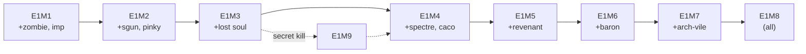

| Level | E1M1 | E1M2 | E1M3 | E1M4 | E1M5 | E1M6 | E1M7 | E1M8 | E1M9 |
|---|---:|---:|---:|---:|---:|---:|---:|---:|---:|
| **Par (s)** | 30 | 75 | 120 | 90 | 165 | 180 | 180 | 30 | 165 |

## Architecture

~8,000 lines of C11. The render loop feeds whole tics into a fixed **35 Hz
deterministic sim** and interpolates the visuals between the last two.

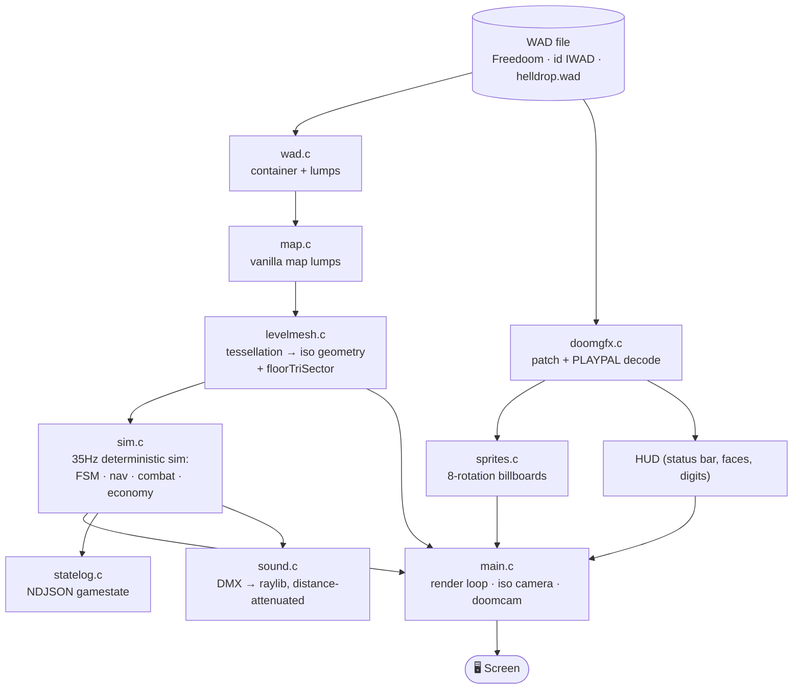

| Layer | Module | Responsibility |
|---|---|---|
| **Data** | `wad.c`, `map.c` | WAD container; vanilla map-lump decode (hostile-data safe, no node format needed) |
| **Geometry** | `levelmesh.c` | libtess2 tessellation → extruded flat-shaded iso meshes + per-triangle sector ids |
| **Simulation** | `sim.c` | the whole game: Doom Guy FSM, A\* nav, movers/triggers, combat, the economy |
| **Presentation** | `sprites.c`, `doomgfx.c`, `sound.c` | authentic billboards, status-bar graphics, DMX audio |
| **Shell** | `main.c` | game loop, orthographic `Camera3D` iso view, doomcam, HUD, input |
| **Instrumentation** | `statelog.c` | the NDJSON debugging contract |
| **Tooling** | `tools/mkwad.c` | the asset-pack assembler |

**Tech stack:** C11 · **raylib 6.0** (vendored, static, pinned by `RAYLIB_TAG`)
· **libtess2** (vendored, robust concave tessellation) · a minimal macOS `.app`
bundle for the Dock/⌘-Tab icon · NDJSON for the state log · `ffmpeg`/ImageMagick
for the media in this README.

> **The 2.5D cheat:** there's no true 3D renderer. The world is extruded
> flat-shaded geometry (floors + wall quads, vertex-color lighting, no
> ceilings) viewed through an *orthographic* `Camera3D`. It reads as clean
> isometric Doom while staying a straightforward mesh draw.

## The authentic-art pipeline

Helldrop ships with **its own redistributable WAD** so it has an identity
without requiring you to own Doom — while still preferring your id IWAD when
you have one.

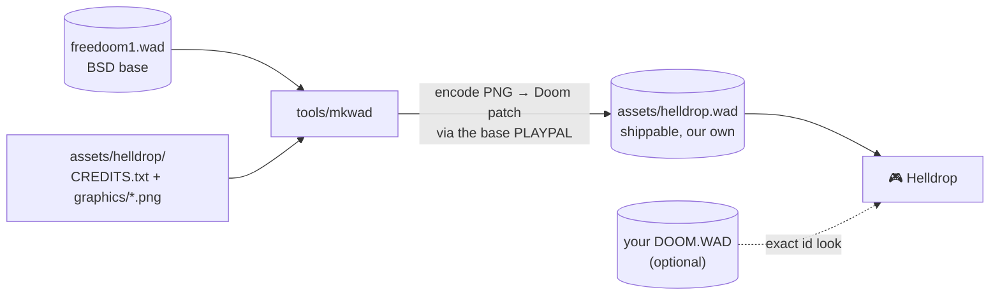

`tools/mkwad` reuses the engine's own `wad.c` + `doomgfx.c` decoders (so the
patch codec lives in exactly one place). It copies the Freedoom base through,
then layers our overrides: raw `*.lmp`/`*.txt` lumps verbatim, and `*.png`
graphics encoded to Doom's picture format by nearest-match against the base
palette. The first reskin is the hell-forged status bar; `make bake-hud`
re-derives those tinted source PNGs after a Freedoom version bump.

**WAD precedence** (no `--wad` given): an id IWAD → `assets/helldrop.wad` →
`assets/freedoom1.wad`. Unlike an id IWAD, `helldrop.wad` is legal to ship —
but it's a reproducible build artifact, so it's `.gitignore`d like every WAD;
its *sources* live in `assets/helldrop/`. **id assets are never committed.**

## The gamestate log (debugging contract)

Every run appends NDJSON to `logs/run-<timestamp>.ndjson` (`logs/latest.ndjson`
symlinks the live file; `./debug.sh` tails it). Events are written as they
happen; full gamestate snapshots land at 5 Hz. When something looks wrong, the
log must always contain enough state to reconstruct it — so **any new gameplay
state added to the code is added to the snapshot in the same change.**

```bash
./debug.sh                                   # tail the live log
jq -c 'select(.type=="target_switch")' logs/latest.ndjson   # why did he turn?
```

Event types include `drop`, `verb`, `infight`, `resurrect`, `corpse_gibbed`,
`barrel_explode`, `target_switch`, `teleport`, `lift`, `door`, `dg_damage`,
`mob_death`, `weapon_switch`, `doomguy_replan`, and `nav_edge_banned`.

## Determinism & testing

The sim is fully deterministic — all randomness flows through one seeded
`SimRandom`, so a given level plays out identically every time (the **G** key
replays the exact same run). That makes it testable without a human:

```bash
# Visual verification, headless: render to selftest.png and exit.
./Helldrop.app/Contents/MacOS/helldrop --map E1M1 --selftest --turbo 8

# The balance contract (E1M1 baseline):
#   unaided  → he reaches the exit at ~159.5s  (you lose)
#   autodrop → he dies at ~16.8s               (you win)
./Helldrop.app/Contents/MacOS/helldrop --map E1M1 --turbo 60 --exit-after 8000
./Helldrop.app/Contents/MacOS/helldrop --map E1M1 --turbo 60 --autodrop --exit-after 8000
```

The footage in this README was produced deterministically with
`--dump-frames`, then stitched with `ffmpeg` — reproducible frame-for-frame.

## Project layout

```
helldrop/
├── run.sh · debug.sh        # build+launch · tail the live log
├── Makefile                 # vendored raylib 6.0, .app bundle, WAD + helldrop.wad targets
├── CLAUDE.md · DESIGN.md     # the build/architecture contract · full design rationale
├── src/
│   ├── main.c               # game loop, iso camera, doomcam, HUD, input
│   ├── sim.{c,h}            # the deterministic 35Hz sim (the whole game)
│   ├── wad.c · map.c         # WAD container · vanilla map decode
│   ├── levelmesh.c          # tessellation → isometric geometry
│   ├── sprites.c            # 8-rotation Doom billboards
│   ├── doomgfx.c            # patch/PLAYPAL decoder, status-bar graphics
│   ├── sound.c              # DMX → raylib audio
│   └── statelog.c           # NDJSON writer
├── tools/mkwad.c            # the asset-pack assembler
├── assets/helldrop/         # our WAD's committed override sources (CREDITS, HUD art)
└── third_party/libtess2     # vendored tessellator
```

## Legal & attribution

- **id Software's Doom assets are copyrighted.** This project never vendors or
  commits them. The `.gitignore` blocks `assets/*.wad`. *Bring your own IWAD*
  for the authentic look.
- **Freedoom** (the bundled default level/art data, and the base of
  `helldrop.wad`) is distributed under a **3-clause BSD license** — see
  [`assets/helldrop/CREDITS.txt`](assets/helldrop/CREDITS.txt). © the Freedoom
  project.
- **raylib** is © Ramon Santamaria, zlib/libpng license. **libtess2** is under
  the SGI Free Software License B.

## Roadmap & known limits

- Some Doom 2 maps' progression (e.g. MAP01-class) can still dead-end at
  `NO_GOAL` — more floor specials (stair builders, donuts) needed for full
  unaided routing. (Retail Entryway *does* complete; Freedoom2's MAP01 differs.)
- Key doors currently open unlocked (logged); no in-game music yet.
- Future: an inverted difficulty scale and more original art layered into the pack.

---

<div align="center">

*Built in C with [raylib](https://www.raylib.com/). Reverse-Doom. You are Hell — act like it.*

</div>
